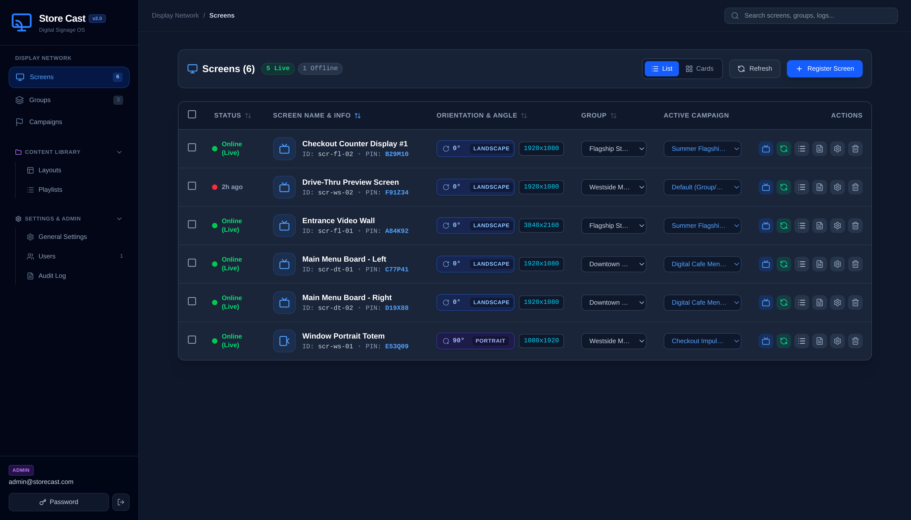
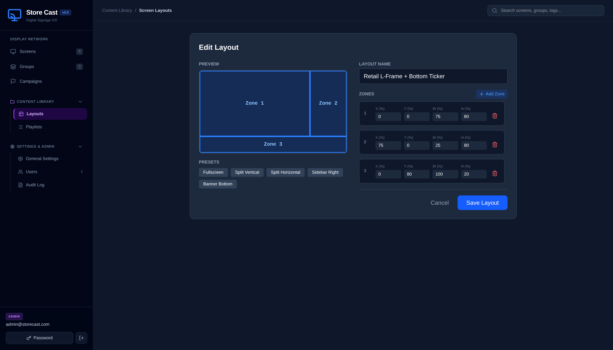

# Store Cast - Modern Digital Signage

**Store Cast** is a powerful, self-hosted digital signage solution designed for simplicity and flexibility. Cast your content to any screen, anywhere, with a centralized web-based dashboard. Whether you're managing a single display in a lobby or a network of screens across multiple locations, Store Cast provides the tools you need to deliver dynamic content effortlessly.

### 📸 Screenshots

#### Admin Dashboard — Display Network Management


#### Multi-Zone Screen Layout Designer


### ✨ Key Features

-   **Web-Based Dashboard**: Manage all your screens, playlists, campaigns, and users from a clean and intuitive web interface.
-   **Multi-Zone Layout Designer**: Visually split screens into custom zones (sidebars, L-frames, tickers, split-screens) and assign independent playlists to each zone.
-   **Multi-Content Support**: Display images, videos, websites, and YouTube content with hardware-accelerated gapless playback.
-   **Flexible Grouping**: Organize screens into groups to push targeted campaigns and playlists to multiple displays at once.
-   **User Management**: Role-based access control with `ADMIN` and `OWNER` roles to delegate management.
-   **Real-Time Updates**: Changes made in the dashboard are pushed instantly to screens via WebSockets.
-   **Cross-Platform Player**: The player is a web app that can run on any device with a modern browser. It is optimized for Android TV boxes and can be easily packaged using Capacitor.
-   **Lightweight & Self-Hosted**: Runs on your own Linux server, giving you full control over your data and infrastructure. Built with Node.js, Express, React, and SQLite.

---

## Production Deployment on Linux

This guide provides step-by-step instructions for installing, configuring, and maintaining the Store Cast server on a Linux-based operating system (e.g., Ubuntu, Debian).

### Table of Contents

1.  [Prerequisites](#prerequisites)
2.  [Installation](#installation)
3.  [Configuration](#configuration)
    - [Reverse Proxy (NGINX)](#reverse-proxy-nginx)
    - [Firewall (UFW)](#firewall-ufw)
    - [Email for Password Resets](#email-for-password-resets)
4.  [Running the Application](#running-the-application)
    - [Manual Start](#manual-start)
    - [Autostart on Boot (PM2)](#autostart-on-boot-pm2)
5.  [Initial Login](#initial-login)
6.  [Backup Strategy](#backup-strategy)
    - [Using rclone with Google Drive](#using-rclone-with-google-drive)

---

### Prerequisites

Before you begin, ensure your server has the following software installed:

-   A Linux server (Ubuntu 20.04+ is recommended).
-   `git`: For cloning the repository.
-   `Node.js` (v16 or later) and `npm`.
-   `nginx`: To act as a reverse proxy for your domains.
-   `ufw`: A simple firewall to secure your server.

You can install these on Ubuntu/Debian with:

```bash
sudo apt update
sudo apt install -y git nodejs npm nginx ufw
```

---

### Installation

1.  **Clone the Repository**
    Clone the project to a directory of your choice, for example, `/var/www/store-cast`.

    ```bash
    sudo git clone https://github.com/your-org/store-cast.git /var/www/store-cast
    sudo chown -R $USER:$USER /var/www/store-cast
    cd /var/www/store-cast
    ```

2.  **Install Backend Dependencies**
    Navigate to the `backend` directory and install the required Node.js packages.

    ```bash
    cd backend
    npm install
    ```

3.  **Build the Frontend**
    Navigate to the root directory, install dependencies, and build the React application. This generates the `dist` folder required by the server.

    ```bash
    cd /var/www/store-cast
    npm install
    npm run build
    sudo chown -R $USER:$USER /var/www/store-cast
    ```

4.  **Install PM2 Globally**
    PM2 is a process manager that will keep your application running.

    ```bash
    sudo npm install -g pm2
    ```

---

### Configuration

The Store Cast server runs two services on different ports:
-   **Screen Service**: Port `8765` (for players/screens)
-   **Admin Service**: Port `8766` (for the management dashboard)

We will use NGINX to direct traffic from your domains to these internal ports.

#### Reverse Proxy (NGINX)

1.  **Create an NGINX Configuration File**
    Create a new config file for your Store Cast instance.

    ```bash
    sudo nano /etc/nginx/sites-available/store-cast
    ```

2.  **Add the Following Configuration**
    Paste the content below into the file. **Remember to replace `admin.yourdomain.com` and `tv.yourdomain.com` with your actual domains.**

    ```nginx
    # Admin Dashboard Server Block
    server {
        listen 80;
        server_name admin.yourdomain.com;

        location / {
            proxy_pass http://localhost:8766;
            proxy_http_version 1.1;
            proxy_set_header Upgrade $http_upgrade;
            proxy_set_header Connection 'upgrade';
            proxy_set_header Host $host;
            proxy_cache_bypass $http_upgrade;
            client_max_body_size 1024M;
        }
    }

    # Screen Player Server Block
    server {
        listen 80;
        server_name tv.yourdomain.com;

        location / {
            proxy_pass http://localhost:8765;
            proxy_http_version 1.1;
            proxy_set_header Upgrade $http_upgrade;
            proxy_set_header Connection 'upgrade';
            proxy_set_header Host $host;
            proxy_cache_bypass $http_upgrade;
            client_max_body_size 1024M;
        }
    }
    ```

3.  **Enable the Site and Test NGINX**
    Create a symbolic link to enable the configuration and test it for syntax errors.

    ```bash
    sudo ln -s /etc/nginx/sites-available/store-cast /etc/nginx/sites-enabled/
    sudo nginx -t
    ```

    If the test is successful, restart NGINX to apply the changes.

    ```bash
    sudo systemctl restart nginx
    ```

4.  **(Recommended) Setup SSL with Let's Encrypt**
    For a production environment, you should secure your sites with SSL. You can get free certificates from Let's Encrypt using `certbot`.

    ```bash
    sudo apt install certbot python3-certbot-nginx
    sudo certbot --nginx -d admin.yourdomain.com -d tv.yourdomain.com
    ```
    Follow the on-screen instructions. Certbot will automatically update your NGINX configuration to handle HTTPS.

#### Firewall (UFW)

Configure the Uncomplicated Firewall (UFW) to allow essential traffic.

```bash
sudo ufw allow ssh          # Allows you to connect to your server
sudo ufw allow 'Nginx Full' # Allows both HTTP and HTTPS traffic
sudo ufw enable
```

#### Email for Password Resets

For the "Forgot Password" feature to work, you must configure SMTP credentials.

1.  Start the server once (`npm start` inside `backend`) to generate the `data` directory and `config.json` file.
2.  Edit the configuration file: `nano /var/www/store-cast/backend/data/config.json`.
3.  Fill in your SMTP provider's details. For Gmail, you will need to generate an [App Password](https://myaccount.google.com/apppasswords).

    ```json
    {
      "allowOwnerEdit": true,
      "mailHost": "smtp.gmail.com",
      "mailPort": 465,
      "mailUser": "your-email@gmail.com",
      "mailPass": "your-gmail-app-password",
      "mailFrom": "your-email@gmail.com"
    }
    ```

---

### Running the Application

#### Manual Start
You can run the server directly for testing purposes.

```bash
cd /var/www/store-cast/backend
npm start
```

#### Autostart on Boot (PM2)

To ensure the server runs continuously and restarts automatically, use PM2.

1.  **Start the Application with PM2**
    Navigate to the backend directory and start the server. This command will start the app, name it "store-cast-server", and daemonize it.

    ```bash
    cd /var/www/store-cast/backend
    pm2 start index.js --name "store-cast-server"
    ```

2.  **Create a Startup Script**
    This command generates a systemd service for PM2 itself, allowing it to restart on boot.

    ```bash
    pm2 startup
    ```
    PM2 will output a command that you need to copy and run. It will look something like this:
    `sudo env PATH=$PATH:/usr/bin /usr/lib/node_modules/pm2/bin/pm2 startup systemd -u your-user --hp /home/your-user`
    
    **Copy the command provided in your terminal and execute it.**

3.  **Save the Process List**
    Save the currently running application list so PM2 knows what to start on reboot.

    ```bash
    pm2 save
    ```

4.  **Managing the Application**
    You can now manage your application using these commands:
    -   `pm2 list`: View the status of your running applications.
    -   `pm2 logs store-cast-server`: View the logs in real-time.
    -   `pm2 restart store-cast-server`: Restart the application.
    -   `pm2 stop store-cast-server`: Stop the application.

---

### Initial Login

Once the server is running, you can access the dashboard.

-   **URL**: `http://admin.yourdomain.com` (or your admin domain)
-   **Default Username**: `admin@storecast.com`
-   **Default Password**: `password`

> **IMPORTANT:** Log in immediately and change the default password via the "Change Password" button in the header.

---

### Backup Strategy

All user data, device configurations, and playlists are stored in the `backend/data` directory. **It is critical to back up this directory regularly.**

This guide demonstrates how to set up automated daily backups to Google Drive using `rclone`.

#### Using rclone with Google Drive

1.  **Install rclone**

    ```bash
    sudo apt install rclone
    ```

2.  **Configure rclone**
    Run the interactive configuration to link your Google Drive account.

    ```bash
    rclone config
    ```
    -   Select `n` for a new remote.
    -   Give it a name (e.g., `gdrive`).
    -   Choose `drive` for Google Drive.
    -   Follow the prompts for authentication. You will be asked to copy a link into your browser to authorize `rclone`.

3.  **Create a Backup Script**
    Create a script to handle the backup logic.

    ```bash
    mkdir ~/scripts
    nano ~/scripts/backup_storecast.sh
    ```

    Paste the following script content. Adjust the `RCLONE_REMOTE`, `BACKUP_SOURCE`, and `BACKUP_DEST` variables as needed.

    ```bash
    #!/bin/bash
    
    # --- Configuration ---
    RCLONE_REMOTE="gdrive" # The name you gave your rclone remote
    BACKUP_SOURCE="/var/www/store-cast/backend/data"
    BACKUP_DEST="/storecast_backups" # A folder name in your Google Drive
    LOG_FILE="/var/log/rclone_storecast.log"
    DATE=$(date +"%Y-%m-%d")

    # --- Script ---
    echo "--- Starting Store Cast backup for ${DATE} ---" >> $LOG_FILE

    # Sync the data directory to a dated folder on the remote
    # Use 'sync' to efficiently update only changed files.
    rclone sync "$BACKUP_SOURCE" "${RCLONE_REMOTE}:${BACKUP_DEST}/${DATE}" --log-file=$LOG_FILE -v

    # Optional: Remove remote backups older than 30 days
    rclone delete "${RCLONE_REMOTE}:${BACKUP_DEST}" --min-age 30d --log-file=$LOG_FILE -v

    echo "--- Backup finished ---" >> $LOG_FILE
    ```

4.  **Make the Script Executable**

    ```bash
    chmod +x ~/scripts/backup_storecast.sh
    ```

5.  **Schedule a Cron Job**
    Set up a cron job to run the backup script automatically every day at 3:00 AM.

    ```bash
    crontab -e
    ```

    Add the following line to the end of the file:

    ```crontab
    0 3 * * * /home/your-user/scripts/backup_storecast.sh
    ```
    Replace `your-user` with your Linux username. Your installation is now complete and includes automated backups.
